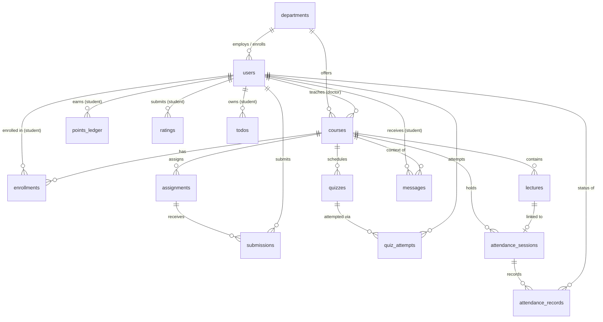

# A Plus (A+) – Relational Data Model Specification

> **Target Audience:** FastAPI + SQL Server Backend Engineering Team  
> **Database Engine:** Microsoft SQL Server 2019+  
> **Naming Convention:** snake_case tables & columns, standard ISO datetime strings (UTC).

This document outlines the relational database entities, fields, relationships, and constraints powering the A Plus LMS platform.

---

## 1. Entity Relationship Overview

---

## 2. Table Schemas

### 2.1 `departments`
Academic departments within faculties.
* `id` VARCHAR(36) PRIMARY KEY
* `name` NVARCHAR(120) NOT NULL UNIQUE (e.g. "Computer Science")
* `code` VARCHAR(10) NOT NULL UNIQUE (e.g. "CS", "IS")
* `college` NVARCHAR(160) NOT NULL
* `created_at` DATETIME2 NOT NULL DEFAULT SYSUTCDATETIME()

### 2.2 `users`
Accounts across all platform roles (student, doctor, department_admin, super_admin).
* `id` VARCHAR(36) PRIMARY KEY
* `email` VARCHAR(120) NOT NULL UNIQUE
* `password_hash` VARCHAR(255) NOT NULL
* `full_name` NVARCHAR(120) NOT NULL
* `role` VARCHAR(30) NOT NULL CHECK (`role` IN ('student', 'doctor', 'department_admin', 'super_admin'))
* `department_id` VARCHAR(36) NULL REFERENCES `departments(id)`
* `university_id` VARCHAR(50) NULL UNIQUE
* `disabled` BIT NOT NULL DEFAULT 0
* `created_at` DATETIME2 NOT NULL DEFAULT SYSUTCDATETIME()

### 2.3 `courses`
Offered curriculum units.
* `id` VARCHAR(36) PRIMARY KEY
* `code` VARCHAR(20) NOT NULL UNIQUE (e.g. "SE301")
* `title` NVARCHAR(150) NOT NULL
* `department_id` VARCHAR(36) NOT NULL REFERENCES `departments(id)`
* `doctor_id` VARCHAR(36) NOT NULL REFERENCES `users(id)`
* `credit_hours` INT NOT NULL DEFAULT 3
* `schedule` NVARCHAR(100) NULL
* `room` NVARCHAR(50) NULL
* `total_lectures` INT NOT NULL DEFAULT 12

### 2.4 `enrollments`
Student course registrations.
* `id` VARCHAR(36) PRIMARY KEY
* `student_id` VARCHAR(36) NOT NULL REFERENCES `users(id)`
* `course_id` VARCHAR(36) NOT NULL REFERENCES `courses(id)`
* `enrolled_at` DATETIME2 NOT NULL DEFAULT SYSUTCDATETIME()
* **Constraint:** UNIQUE(`student_id`, `course_id`)

### 2.5 `lectures`
Weekly course lecture topics and uploaded materials.
* `id` VARCHAR(36) PRIMARY KEY
* `course_id` VARCHAR(36) NOT NULL REFERENCES `courses(id)`
* `number` INT NOT NULL
* `title` NVARCHAR(200) NOT NULL
* `date` DATE NOT NULL
* `material_url` NVARCHAR(500) NULL

### 2.6 `assignments`
Course assignments published by doctors.
* `id` VARCHAR(36) PRIMARY KEY
* `course_id` VARCHAR(36) NOT NULL REFERENCES `courses(id)`
* `title` NVARCHAR(200) NOT NULL
* `description` NVARCHAR(MAX) NOT NULL
* `due_date` DATETIME2 NOT NULL
* `max_grade` INT NOT NULL DEFAULT 20
* `created_at` DATETIME2 NOT NULL DEFAULT SYSUTCDATETIME()

### 2.7 `submissions`
Student assignment deliverables.
* `id` VARCHAR(36) PRIMARY KEY
* `assignment_id` VARCHAR(36) NOT NULL REFERENCES `assignments(id)`
* `student_id` VARCHAR(36) NOT NULL REFERENCES `users(id)`
* `content` NVARCHAR(MAX) NOT NULL
* `submitted_at` DATETIME2 NOT NULL DEFAULT SYSUTCDATETIME()
* `is_late` BIT NOT NULL DEFAULT 0
* `ai_score_out_of_10` DECIMAL(3, 1) NULL -- VISIBLE ONLY TO DOCTOR
* `ai_feedback` NVARCHAR(MAX) NULL
* `ai_confidence` DECIMAL(3, 2) NULL
* `doctor_final_grade` INT NULL
* `doctor_feedback` NVARCHAR(MAX) NULL
* `graded_at` DATETIME2 NULL
* **Constraint:** UNIQUE(`assignment_id`, `student_id`)

### 2.8 `quizzes` & `quiz_attempts`
Automated assessment quizzes and student attempts.
* `quizzes`: `id`, `course_id`, `title`, `duration_minutes`, `available_from`, `available_to`, `questions_json`
* `quiz_attempts`: `id`, `quiz_id`, `student_id`, `answers_json`, `score`, `total`, `submitted_at`
* **Constraint:** UNIQUE(`quiz_id`, `student_id`)

### 2.9 `attendance_sessions` & `attendance_records`
Lecture attendance logging.
* `attendance_sessions`: `id`, `course_id`, `lecture_id` (NULLABLE), `date`, `method` ('manual'|'dynamic_qr')
* `attendance_records`: `id`, `session_id`, `student_id`, `status` ('present'|'absent'|'excused')
* **Constraint:** UNIQUE(`session_id`, `student_id`)

### 2.10 `messages`
Student inbox alerts, system absence warnings, and notices.
* `id` VARCHAR(36) PRIMARY KEY
* `sender_id` VARCHAR(36) NULL REFERENCES `users(id)`
* `sender_type` VARCHAR(20) NOT NULL CHECK (`sender_type` IN ('doctor', 'system'))
* `sender_name` NVARCHAR(100) NOT NULL
* `recipient_id` VARCHAR(36) NOT NULL REFERENCES `users(id)`
* `course_id` VARCHAR(36) NULL REFERENCES `courses(id)`
* `type` VARCHAR(20) NOT NULL CHECK (`type` IN ('warning', 'notice', 'suggestion', 'system'))
* `subject` NVARCHAR(200) NOT NULL
* `body` NVARCHAR(MAX) NOT NULL
* `is_read` BIT NOT NULL DEFAULT 0
* `created_at` DATETIME2 NOT NULL DEFAULT SYSUTCDATETIME()

### 2.11 `points_ledger`
Gamification audit log; resets monthly.
* `id` VARCHAR(36) PRIMARY KEY
* `student_id` VARCHAR(36) NOT NULL REFERENCES `users(id)`
* `month` VARCHAR(7) NOT NULL -- Format 'YYYY-MM'
* `source` VARCHAR(30) NOT NULL CHECK (`source` IN ('submission', 'quiz', 'attendance', 'bonus'))
* `points` INT NOT NULL
* `reference_id` VARCHAR(36) NULL
* `description` NVARCHAR(200) NOT NULL
* `created_at` DATETIME2 NOT NULL DEFAULT SYSUTCDATETIME()

### 2.12 `ratings`
Student anonymous evaluation of lectures and doctors.
* `id` VARCHAR(36) PRIMARY KEY
* `student_id` VARCHAR(36) NOT NULL REFERENCES `users(id)` -- Kept private in DB, never exposed to doctor
* `target_type` VARCHAR(20) NOT NULL CHECK (`target_type` IN ('lecture', 'doctor'))
* `target_id` VARCHAR(36) NOT NULL
* `course_id` VARCHAR(36) NULL REFERENCES `courses(id)`
* `score` INT NOT NULL CHECK (`score` BETWEEN 1 AND 5)
* `comment` NVARCHAR(MAX) NULL
* `created_at` DATETIME2 NOT NULL DEFAULT SYSUTCDATETIME()

### 2.13 `todos`
Private student tasks.
* `id` VARCHAR(36) PRIMARY KEY
* `student_id` VARCHAR(36) NOT NULL REFERENCES `users(id)`
* `title` NVARCHAR(200) NOT NULL
* `course_code` VARCHAR(20) NULL
* `due_date` DATE NULL
* `priority` VARCHAR(10) NOT NULL CHECK (`priority` IN ('high', 'medium', 'low'))
* `completed` BIT NOT NULL DEFAULT 0
* `created_at` DATETIME2 NOT NULL DEFAULT SYSUTCDATETIME()

### 2.14 `settings`
Institutional policies and gamification point rules configured at Dean level.
* `id` VARCHAR(36) PRIMARY KEY
* `absence_warning_threshold` INT NOT NULL DEFAULT 2
* `rating_cooldown_days` INT NOT NULL DEFAULT 7
* `points_submission_on_time` INT NOT NULL DEFAULT 50
* `points_quiz_completion` INT NOT NULL DEFAULT 30
* `points_attendance_present` INT NOT NULL DEFAULT 10
* `updated_at` DATETIME2 NOT NULL DEFAULT SYSUTCDATETIME()
* `updated_by` VARCHAR(36) NULL REFERENCES `users(id)`

### 2.15 `broadcasts`
Broadcast announcement log sent across college or department audiences.
* `id` VARCHAR(36) PRIMARY KEY
* `sender_id` VARCHAR(36) NOT NULL REFERENCES `users(id)`
* `scope` VARCHAR(30) NOT NULL CHECK (`scope` IN ('college', 'department'))
* `audience` VARCHAR(50) NOT NULL
* `department_id` VARCHAR(36) NULL REFERENCES `departments(id)`
* `subject` NVARCHAR(200) NOT NULL
* `body` NVARCHAR(MAX) NOT NULL
* `recipient_count` INT NOT NULL DEFAULT 0
* `created_at` DATETIME2 NOT NULL DEFAULT SYSUTCDATETIME()

---

## 3. Cross-Entity Business Constraints

- Every attendance record must reference a student enrolled in the session's course; enforce UNIQUE(`session_id`, `student_id`).
- On the first attendance record that reaches `ABSENCE_WARNING_THRESHOLD` for a student/course, create one unread system warning. Later absences must not create duplicates for that pair.
- Every doctor-created assignment, lecture, quiz, attendance session, message, and bonus award must be scoped to that doctor's courses and enrolled students.
- A student's assignment submission and quiz attempt are each unique per student/resource pair. Keep the AI opinion score private to doctor responses; student responses must never include AI-score fields.
- Message recipients and todo owners are private to each student. A todo's optional `course_code` must refer to a course in which its owner is enrolled.
- Ratings must reference an existing lecture or doctor and a course the student is enrolled in. Keep `student_id` in storage for cooldown enforcement, but do not expose it in doctor rating aggregates.
- Points are immutable ledger entries partitioned by `month` (`YYYY-MM`). Current totals and department ranking use only the current month; bonus history may be reported cumulatively separately.
